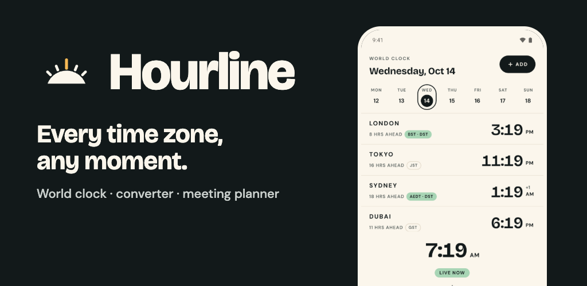
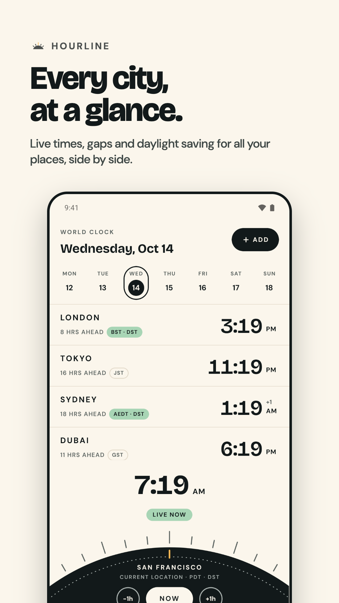
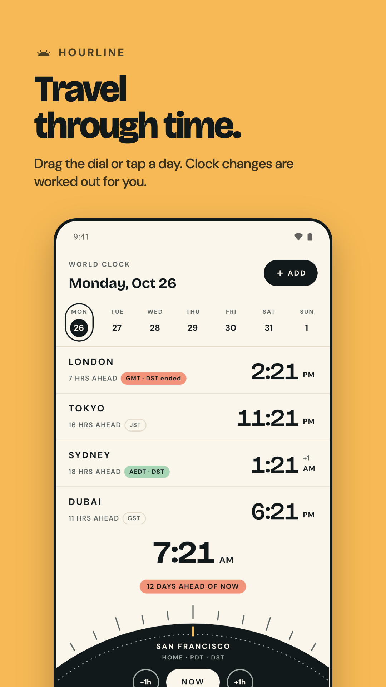
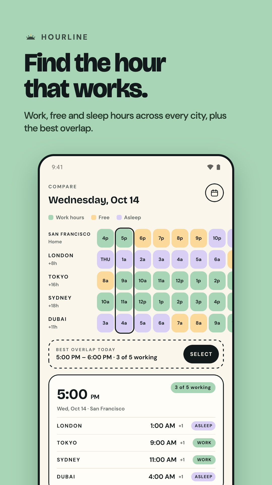
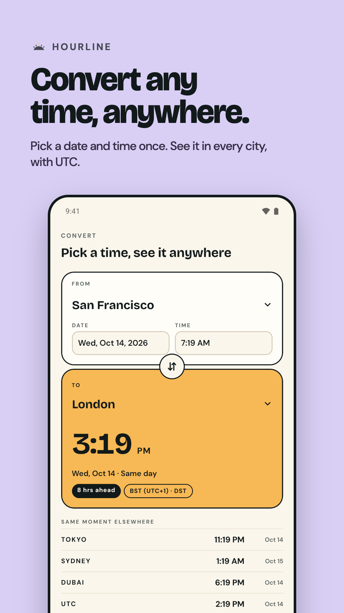
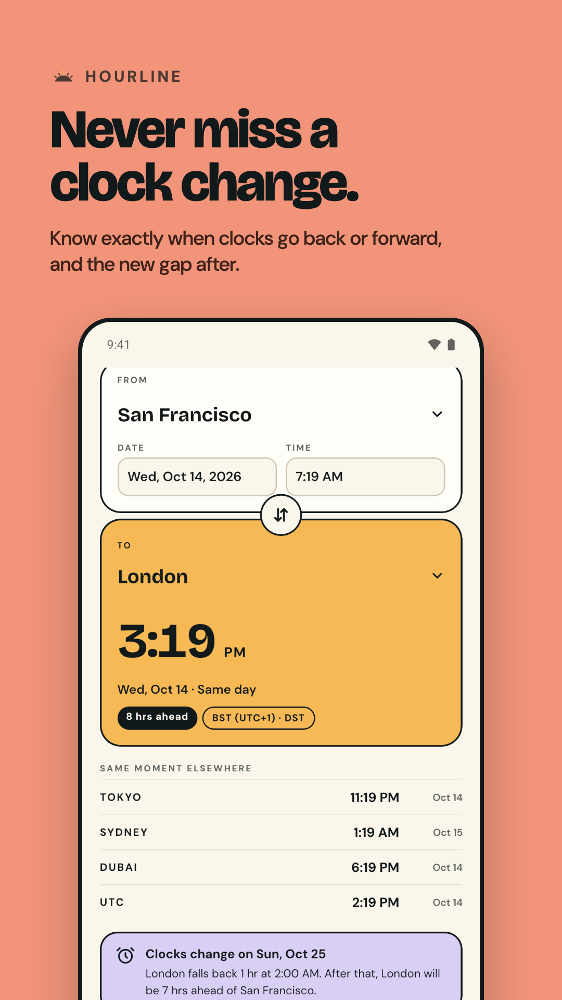
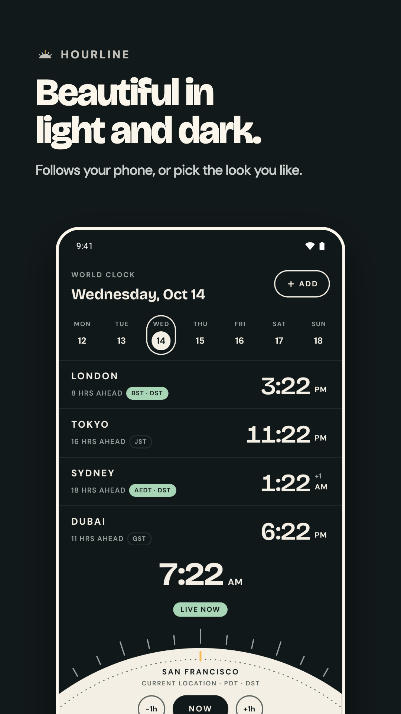
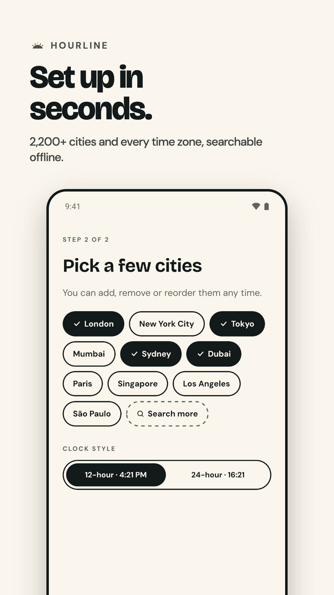

<p align="center">
  
</p>

<h1 align="center">Hourline</h1>

<p align="center">
  A world clock and time zone converter for Android that gets daylight saving right, every time.
</p>

<p align="center">
  <a href="https://hourline.adevtutorials.in/#beta"><b>👉 Join the closed beta on Google Play</b></a>
  &nbsp;·&nbsp;
  <a href="https://hourline.adevtutorials.in">Website</a>
  &nbsp;·&nbsp;
  <a href="https://hourline.adevtutorials.in/privacy">Privacy policy</a>
  &nbsp;·&nbsp;
  <a href="CONTRIBUTING.md">Contributing</a>
</p>

<p align="center">
  <a href="LICENSE"></a>
  
  
</p>

---

## Join the beta

Hourline is in **closed testing on Google Play**. Joining takes about two minutes:

1. Go to **[hourline.adevtutorials.in/#beta](https://hourline.adevtutorials.in/#beta)**.
2. Join the tester group with the Google account you use in Google Play.
3. Tap *Become a tester*, then install Hourline from Google Play.

Please keep it installed for at least 14 days. Google requires that before the app can go public.
Send feedback to **hello@adevtutorials.in**.

## Screenshots

<table>
  <tr>
    <td></td>
    <td></td>
    <td></td>
    <td></td>
  </tr>
  <tr>
    <td></td>
    <td></td>
    <td></td>
    <td></td>
  </tr>
</table>

These are real screenshots from the app. See [`marketing/README.md`](marketing/README.md) for how they're made.

## Features

- **Every city at a glance:** the time, how far ahead or behind, and who is on daylight saving, with real zone names (BST, AEDT…).
- **Time travel:** drag the dial in 15-minute steps, or swipe the week strip to any date in the past or future. When clocks change in between, Hourline says so ("GMT · DST ended").
- **Compare:** an hour grid of work, free and sleep hours for every city, with the best meeting overlap picked for you.
- **Convert:** pick a date and time in one city and see it everywhere, including UTC. You're warned about times skipped when clocks spring forward.
- **Clock-change alerts:** shown when a change is coming within 30 days, with the new gap between your cities.
- **Accurate everywhere:** the app ships its own time zone rules, so every phone gives the same answer.
- **Private:** no account, no ads, no tracking. Everything stays on your phone.
- Light and dark themes, a 12/24-hour clock, haptic feedback, 2,200+ cities searchable offline.

## How accuracy is checked

- **Bundled rules:** time zone rules come from IANA tzdb **2026e**, via the FormatJS `Intl.DateTimeFormat` polyfill ([`src/lib/intl.ts`](src/lib/intl.ts)). The phone's own, possibly outdated, rules are never used.
- **timeanddate.com cross-check:** [`src/lib/tz-timeanddate.test.ts`](src/lib/tz-timeanddate.test.ts) compares the engine with **240 conversions and 19 clock changes** captured from timeanddate.com. Known differences are documented in the test.
- **On-device self-check:** dev builds have one under *Settings → Run time-zone self-check*.

## Tech stack

- [Expo](https://expo.dev) SDK 57 (React Native, Hermes, New Architecture), with [Expo Router](https://docs.expo.dev/router/introduction/)
- [Luxon](https://moment.github.io/luxon/) for time zone maths, in [`src/lib/tz.ts`](src/lib/tz.ts)
- `react-native-gesture-handler`, `react-native-svg`, `expo-haptics`, `expo-localization`, AsyncStorage
- Jest (`jest-expo`) for tests
- EAS Build for signed release builds
- The website is static HTML on Vercel

## Project structure

```
src/app/            screens (Expo Router): onboarding, (tabs)/ home·compare·convert·settings, add-city modal
src/components/     dial, week strip, city row, pill tab bar, haptic Pressable, …
src/lib/            time zone engine, abbreviations, cities, compare logic, haptics, tests
src/state/          app state (AsyncStorage)
src/data/           cities.json (generated from GeoNames by scripts/build-cities.mjs)
plugins/            config plugin for release signing
site/               hourline.adevtutorials.in (landing page, beta signup, privacy policy)
marketing/          raw screenshots and Google Play graphics
docs/               publishing guide, release notes, privacy policy
```

## Development

```bash
npm install
npm run android          # build and install the development build on an emulator/device
npx expo start --dev-client
```

Before committing, run:

```bash
npx expo lint
npx tsc --noEmit
npm test                 # includes the timeanddate.com cross-check
```

`android/` and `ios/` are generated by `expo prebuild` and are not committed. Configure native behaviour in
`app.json` and `plugins/`.

## Releasing

Production builds are signed AABs built with EAS:

```bash
npx eas-cli@latest build --platform android --profile production
```

- [`docs/google-play-publishing.md`](docs/google-play-publishing.md): step-by-step Google Play guide (store listing, closed testing, uploads).
- [`docs/release-notes.md`](docs/release-notes.md): release notes for each version.

## Contributing

Hourline is open source and contributions are welcome. Bug reports with the exact city, date and time are
especially useful. Read [CONTRIBUTING.md](CONTRIBUTING.md) before opening a pull request.
`master` is protected, so every change goes through a reviewed PR.

## Privacy

Hourline collects no data. See the [privacy policy](https://hourline.adevtutorials.in/privacy).

## Credits

- Time zone rules: [IANA Time Zone Database](https://www.iana.org/time-zones) (public domain), bundled through
  [FormatJS](https://formatjs.github.io/) (MIT).
- City data: [GeoNames](https://www.geonames.org/), licensed under
  [CC BY 4.0](https://creativecommons.org/licenses/by/4.0/). `src/data/cities.json` is derived from it.
- Fonts: [Bricolage Grotesque](https://github.com/ateliertriay/bricolage) and
  [DM Sans](https://github.com/googlefonts/dm-fonts), under the [SIL Open Font License 1.1](https://openfontlicense.org/).
- Reference data for the accuracy tests: [timeanddate.com](https://www.timeanddate.com/).

## License

[MIT](LICENSE) © 2026 Abbas Anandwala
